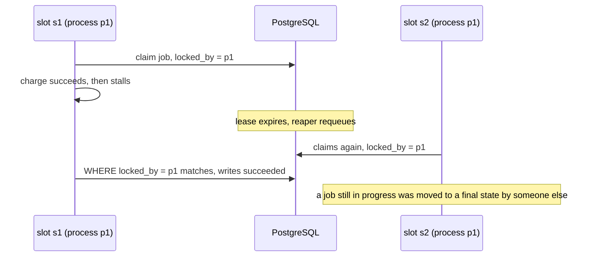

*This is the English version of [a post originally written in Chinese](/posts/tla-plus-for-ai-distributed-code/).*

I've been building a few distributed services lately, and the distributed code AI writes for me keeps falling apart. Each function looks fine on its own: retries, timeouts, logging, passing tests. The problems live *between* functions. What if the database write times out but is still in flight? What if the old worker is still writing at the exact moment its lease expires? What if two versions of the service run side by side during a rolling deploy?

My guess is that the models have seen plenty of distributed code that *looks* right, but haven't really been trained to think distributedly: to walk through every possible interleaving and ask, at each step, "is the system still correct?" They default to single-machine intuition: one step after another, every request eventually gets an answer, a timeout means failure.

Asking the AI for more tests doesn't help either. The tests come from the same line of reasoning as the code, with the same blind spots. Add tests, review, find another counterexample, fix it, review again, and there's yet another one.

What I wanted was something precise and strongly constrained, something an AI can read and implement one-to-one. I landed on TLA+. I've since used this approach on a WebSocket push service and on an executor in a game backend. The production code can't be published, so I applied the same method to a small open-source project as well. Everything I say about it below can be reproduced:

> **Example repository**: [github.com/tursom/pgqueue-tla](https://github.com/tursom/pgqueue-tla) (all code links in this post are pinned to commit [`bafcc3d`](https://github.com/tursom/pgqueue-tla/tree/bafcc3d))
>
> ```bash
> make db     # start a throwaway PostgreSQL
> make tlc    # 20 model-checking runs, about a minute, writes spec/RESULTS.md
> make test   # replay TLC's counterexamples against real PostgreSQL
> ```
>
> You need Go, Java, the TLA+ tools and Docker. Comments and docs in the repository are in Chinese; code snippets in this post have their comments translated.

## Why TLA+

Design documents in prose don't cut it. "Return success after the message is persisted" doesn't say what counts as a persistence timeout, whether a timed-out write can still land later, or what happens if the process dies right before replying. An AI fills those gaps with single-machine intuition, and what it fills in is usually the bug.

TLA+ closes those gaps:

- **State must be explicit.** What's in Redis, what's in the database, what's in each process's memory, what's in flight on the network: all of it becomes variables.
- **Every action is atomic.** Its precondition, which variables it changes and which it leaves alone. Nothing can be left out.
- **Nondeterminism is explicit.** Writes can arrive late, processes can crash or pause between any two steps, Redis can lose data or roll back. Once that's in the spec, TLC explores every interleaving instead of a few "normal" paths.
- **It's plain text.** An AI can read and write it, and it lives in the repository and gets reviewed alongside the code.

A counterexample from TLC is a concrete execution trace that shows, step by step, how the system reached a bad state. That beats anyone's "looks fine to me", human or AI.

## Why now

TLA+ is more than twenty years old. Amazon and Microsoft adopted it long ago for core protocols, but it never spread to ordinary teams. Not because it isn't valuable, but because it's expensive. You have to learn to think in states and actions. A decent spec takes weeks. Then come the model configurations, sanity checks, mutations, test harnesses, code mappings and verification write-ups. And every code change means updating the spec. Most teams that write a spec at all stop at "TLC passed".

AI has driven those costs down. Drafting specs, turning TLC traces into readable explanations, generating mutations in bulk, writing fuzz harnesses, keeping action annotations in the code up to date, writing up results: this is grunt work an AI can now do. For the executor project described below, three models, nearly thirty configurations and about seventy sanity checks and mutations were written and checked within a single day, judging by the commit history. Done the old way, that's weeks of work for one person.

Demand has shifted at the same time. AI has made writing code cheap, so the bottleneck has moved from "writing it" to "knowing it's right", and AI's blind spot for interleavings makes that more urgent. AI is both the reason I need TLA+ and the reason I can afford it.

Two costs haven't gone down. The first is judgment: which failures to model, which properties to state, which assumptions are acceptable. That's still a human call. AI-written specs aren't reliable on their own. The method works because TLC, sanity checks and mutations form a feedback loop that catches the AI's mistakes, not because the AI gets things right. The second is compute: state explosion is still there, and a hundred million states still take half an hour and around 20 GB of disk.

There's also a new risk. Once specs are cheap, you can end up with *spec theater*: lots of models, beautiful result tables, and nobody who really understands what is being verified. Lower barriers mean checking whether the model itself can be trusted matters *more*. Half of the "Pitfalls" section below is about exactly that.

## A runnable example: a payment job queue

Let's first walk through the whole process on the example project, then get to the production experience.

### The problem

Business code inserts payment jobs into PostgreSQL. Several worker processes consume them concurrently, and each job calls an external payment gateway once. The gateway supports idempotency keys: repeating a request with the same key doesn't charge again and returns the original result. But requests can time out, and the money may have been taken even though the response was lost. Workers can crash, or stall for a long time and then wake up. There are just three requirements:

- a job is never charged twice;
- `succeeded` means the customer was charged, `dead` means they definitely weren't (the business notifies the user that payment failed and releases the order);
- every job eventually finishes.

The full requirements are in [REQUIREMENTS.md](https://github.com/tursom/pgqueue-tla/blob/bafcc3d/REQUIREMENTS.md); they are the shared input for both implementations.

### The version the AI wrote directly

[`naive/`](https://github.com/tursom/pgqueue-tla/blob/bafcc3d/naive/naive.go) is what the AI wrote from the requirements alone, without a spec. It looks quite reasonable: claims jobs with `FOR UPDATE SKIP LOCKED`, uses leases, has a reaper, uses the job ID as the idempotency key, and checks `locked_by` when writing results back:

```go
// Finish updates the job based on the charge result: complete on success,
// requeue on failure, mark dead when retries are exhausted.
func (q *Queue) Finish(ctx context.Context, j *Job, chargeErr error) error {
	if chargeErr == nil {
		_, err := q.DB.Exec(ctx, `
			UPDATE naive_jobs SET state = 'succeeded', locked_by = NULL, locked_until = NULL
			WHERE id = $1 AND locked_by = $2`, j.ID, q.WorkerID)
		return err
	}
	_, err := q.DB.Exec(ctx, `
		UPDATE naive_jobs
		SET state = CASE WHEN attempts >= $3 THEN 'dead' ELSE 'queued' END,
		    locked_by = NULL, locked_until = NULL, last_error = $4
		WHERE id = $1 AND locked_by = $2`, j.ID, q.WorkerID, q.MaxAttempts, chargeErr.Error())
	return err
}
```

`WorkerID` is `hostname:pid`, shared by all concurrent slots in a process. This is an extremely common pattern, and it would probably pass code review.

### Writing it as a spec

In the [spec](https://github.com/tursom/pgqueue-tla/blob/bafcc3d/spec/JobQueue.tla), every action corresponds to one database transaction or one gateway call in the code. Three switches describe the design:

- `Fenced`: whether worker writes compare a fence (incremented on every claim), or only `locked_by` like the naive version;
- `CancelBeforeDead`: more on this below;
- `KeyMode`: one idempotency key per job, or one per attempt.

The naive version is `Fenced = FALSE`, `CancelBeforeDead = FALSE`, `KeyMode = "job"`. One model can therefore describe the naive version and the fixed design, and also serve for mutations.

The `WHERE` clause used by worker writes is its own definition, mirroring the SQL in both implementations:

```tla
\* The WHERE condition used when a worker writes the job row
Guard(s) ==
    LET j == slot[s].job
    IN IF Fenced THEN job[j].seq = slot[s].seq /\ job[j].state = "running"
                 ELSE job[j].owner = Proc[s]
```

The gateway is modeled exactly as the requirements describe it, lost responses included:

```tla
\* Call the gateway. It deduplicates by idempotency key:
\*   key closed        -> only "rejected", no charge
\*   key already used  -> returns the original result (ok, or lost response), no new charge
\*   new key           -> ok / lost (charged) or rejected (explicit refusal, not charged)
Send(s, out) ==
    /\ slot[s].pc = "claimed"
    /\ LET j == slot[s].job
           k == KeyOf(s)
       IN /\ CASE k \in closed -> out = "rejected"
                [] k \in keys   -> out \in {"ok", "lost"}
                [] OTHER        -> TRUE
          /\ IF out # "rejected" /\ k \notin keys
               THEN /\ keys' = keys \cup {k}
                    /\ charged' = [charged EXCEPT ![j] = @ + 1]
               ELSE UNCHANGED <<keys, charged>>
          /\ slot' = [slot EXCEPT ![s].pc = "sent", ![s].outcome = out]
    /\ UNCHANGED <<job, cancelRes, closed, badWrite, expires, crashes>>
```

Time is abstracted as "a lease can expire at any moment". However long a worker stalls and however slow the network is, it's all covered by a single `Expire` action, so the safety results don't depend on any timing assumption.

The properties are the requirements, plus one more: "a worker that has lost its claim never modifies the job row". That last one is tracked by a ghost variable, `badWrite`, judged independently at the moment of each write rather than reusing `Guard`:

```tla
NoDoubleCharge == \A j \in Jobs : charged[j] <= 1
SucceededMeansCharged == \A j \in Jobs : job[j].state = "succeeded" => charged[j] >= 1
DeadMeansNotCharged == \A j \in Jobs : job[j].state = "dead" => charged[j] = 0
WritesAuthorized == ~badWrite
```

### TLC's two counterexamples

The naive version does avoid double charges; TLC confirms that. The other two properties each fall to a 7-step counterexample.

**A dead job that was actually charged** (`naive-dead`):

1. A worker claims the job; the first charge succeeds, but the response is lost.
2. The worker treats it as a failure and the job is requeued.
3. The job is claimed again. The second request hits the idempotency key, so no second charge, but that response is lost too.
4. Retries are exhausted and the job is marked `dead`. The user is told the payment failed, but the money is gone.

**A stale worker overwrites a job someone else is running** (`naive-writes`):



Both counterexamples are short, but both need "lost response, lease expiry, reap, re-claim" to happen in a specific order. Tests of the normal path won't stumble into them.

### Found while writing the spec: the requirement was unachievable

My first idea for the fix was "record a may-have-charged flag in the database before charging, and use it when retries run out." While writing the spec, it became clear this couldn't work: after a job has been given up on, a worker that lost its lease long ago can still wake up and send the charge request. A fence in the database stops stale *writes to the database*. It can't stop stale *calls to the gateway*.

In other words, with only a `Charge` endpoint, "`dead` means not charged" is impossible to guarantee when workers can stall arbitrarily. That's not an implementation bug. It's a contradiction between the requirements and the external interface.

So the requirements changed: the gateway must provide `Cancel(key)`, which atomically closes an idempotency key that hasn't been charged and reports whether it had been. Real payment gateways usually offer something equivalent; for example, once a payment intent is canceled it can no longer be confirmed. The change is recorded at the end of the requirements document.

TLC didn't report this. It surfaced on its own while I was writing down every action and every piece of state. That's part of the value of writing a spec: it forces you to answer questions a design document lets you gloss over.

### The fixed design and the results

The fixed design has three mechanisms:

| Mechanism | What it fixes |
| --- | --- |
| **Fence**: incremented on every claim; every worker write carries `WHERE fence = $n AND state = 'running'` | Stale workers can't modify the job row |
| **One idempotency key per job**: all attempts share `job-<id>` | Neither retries nor stale workers can charge twice |
| **Cancel before giving up**: exhausted jobs go to `canceling`; the reaper calls the gateway's `Cancel` and marks the job `succeeded` if it was charged, `dead` otherwise | `dead` really means not charged; a stale worker's later charge is rejected by the gateway |

[`spec/check.sh`](https://github.com/tursom/pgqueue-tla/blob/bafcc3d/spec/check.sh) runs 20 checks. Each one states its expected outcome, a check only counts if the result matches exactly, and the summary is written to [spec/RESULTS.md](https://github.com/tursom/pgqueue-tla/blob/bafcc3d/spec/RESULTS.md):

| Group | What | Result |
| --- | --- | --- |
| naive | write authorization, dead means not charged | 7-step counterexample each |
| naive | no double charge, succeeded means charged, final states stable | pass |
| fixed design | all safety properties; largest config: 3 slots, 2 jobs, 3 attempts, 2 lease expiries, 2 crashes | pass, 1,365,705 states, depth 28 |
| fixed design | liveness: every job eventually finishes | pass |
| reachability checks | 6 scenarios expected to be reachable | all reachable, 5–9 steps |
| model mutations | no fence / no Cancel / per-attempt keys | violate write authorization / dead means not charged / no double charge, respectively |
| assumption | gateway forgets charged idempotency keys | violates no double charge, 7 steps |

The last three groups answer one question: **did the check pass only because the model is wrong?**

- Reachability checks are properties written to be violated: "a stale worker sent a charge", "a stale charge was rejected because the key was closed", "Cancel discovered the job had in fact been charged". TLC reporting a violation proves these scenarios really are reachable in the model.
- Mutations remove one mechanism of the fixed design at a time, confirming each one is necessary and that the properties are strong enough to catch its absence.
- The assumption check shows the model depends on the gateway keeping idempotency keys forever. If a real gateway only keeps them for a limited time (some keep them for 24 hours) and a job's retry window is longer, you get double charges. That assumption has to be checked against any real gateway.

### Implementing the spec, then cross-checking with fuzzing

[`queue/`](https://github.com/tursom/pgqueue-tla/blob/bafcc3d/queue/queue.go) is the version implemented from the spec. Each method performs exactly one database transaction or one gateway call, matching the model's atomicity, and its comment names the corresponding action. For example, the `WHERE` clause in `Finish` is exactly the model's `Guard` with `Fenced = TRUE`:

```go
// Finish wraps up based on the charge result: complete on success; otherwise requeue,
// or move to canceling to await Cancel when retries are exhausted.
// Returns false if this claim is no longer valid (reaped or taken over); nothing changed.
//
// Model action: Finish
func (q *Queue) Finish(ctx context.Context, t *Task, out Outcome) (bool, error) {
	var sql string
	args := []any{t.ID, t.Fence}
	if out == OK {
		sql = `
			UPDATE jobs SET state = 'succeeded', locked_by = NULL, lease_until = NULL
			WHERE id = $1 AND fence = $2 AND state = 'running'`
	} else {
		sql = `
			UPDATE jobs
			SET state = CASE WHEN attempts >= $3 THEN 'canceling' ELSE 'queued' END,
			    locked_by = NULL, lease_until = NULL, last_error = $4
			WHERE id = $1 AND fence = $2 AND state = 'running'`
		args = append(args, q.MaxAttempts, outcomeName(out))
	}
	// ...
}
```

[`sim/`](https://github.com/tursom/pgqueue-tla/blob/bafcc3d/sim/sim.go) drives both implementations step by step through the model's actions against real PostgreSQL and checks the same invariants after every step. The oracle never calls the code under test. Claim sequence numbers are tracked by the harness itself, whether a write happened is decided by comparing full-row JSON snapshots, and charge counts come from the fake gateway. If the code's own checks are wrong, the oracle isn't wrong with them.

TLC's counterexamples translate directly into tests. Here is `naive-writes`: the same sequence of actions violates the property on naive and is safe on queue:

```go
func TestReplayStaleFinish(t *testing.T) {
	// s1 charges successfully, then stalls; the lease expires and the job is reaped;
	// s2 in the same process claims it again; s1 wakes up and writes succeeded anyway.
	steps := []Step{claim(0), send(0, gateway.OK), tick, reap, claim(1), finish(0)}

	v, _ := replay(t, newEnv(t, naiveSame), 1, steps)
	if v == nil || v.Property != "WritesAuthorized" {
		t.Fatalf("naive should violate WritesAuthorized, got %v", v)
	}

	v, states := replay(t, newEnv(t, fixed), 1, steps)
	if v != nil {
		t.Fatalf("queue should not violate anything: %v", v)
	}
	if states[0] != "running" {
		t.Fatalf("the stale Finish should be blocked by the fence and s2 still running, got %s", states[0])
	}
}
```

The output of `make test` shows the naive version failing on a real database (translated):

```text
naive: step 6 violates WritesAuthorized: s1 lost its claim but still changed job 1 from running to succeeded
naive: step 6 violates DeadMeansNotCharged: job 1 is dead but was charged 1 time
naive: step 7 violates DeadMeansNotCharged: job 1 is dead but was charged 1 time
```

The third line is the scenario found while writing the spec: the stale worker sends its charge after the job was given up on. On queue, that charge is rejected because the idempotency key has been closed.

All implementation-side checks:

| Check | Result |
| --- | --- |
| Replaying 3 scenarios (2 TLC counterexamples + the one found while writing the spec) | all reproduce on naive, none violate on queue |
| 1,000 random action programs (fixed seed, reproducible) | naive with shared-process slots: 11 violations; separate processes: 6; queue: all pass, and every job eventually finishes |
| Go native fuzzing, 60 seconds | 11,943 executions, no violations |
| Implementation mutations via `go test -overlay`: drop the fence condition / mark dead without Cancel / per-attempt keys | all caught by the tests |

The random-testing row deserves a second look. TLC hands you the shortest 7-step counterexample directly. Random programs first hit the dead-job bug at program #52 and the write-authorization bug at program #388, a hit rate of about 1%. And the vocabulary the random tests draw from (lease expiry, lost responses, reaping, crashes) itself came out of the model. Without the model, you wouldn't even know what to randomize.

### Verify it yourself

```bash
git clone https://github.com/tursom/pgqueue-tla && cd pgqueue-tla
make db          # throwaway PostgreSQL on 127.0.0.1:55432
make tlc         # 20 model-checking runs; reports success when all match expectations
make test        # replays, random comparison, assumption demo
make fuzz        # state-machine fuzzing, 60 seconds by default
make mutate      # implementation mutations; reports success when all are caught
```

Full TLC traces are in `.tlc/<check-name>/tlc.log`. To see what a mechanism does, flip a switch in `spec/check.sh` and rerun, or break `queue/queue.go` and run `make test`.

## In production

The example project exists so the method can be verified in public. What convinced me to use it in the first place were the two production projects below.

### Push service: resuming reliable delivery

This is a WebSocket push service. Messages in each topic carry an increasing seq, allocated in Redis and then stored in MongoDB. Clients remember their position in each topic, send it when reconnecting, and the server replays everything after it. The guarantee fits in one sentence: **if the publisher was told a message succeeded, the client will receive it.**

The hard part is gaps. A seq can be allocated and then the write fails, the publisher gives up, or the service crashes, all leaving a gap. A write can also land after it has timed out. When resuming hits a gap, not skipping it leaves the client stuck. Skipping it risks a late message landing on that exact seq, after which the client has saved a position past it and will never get it back.

#### Test-and-audit rounds that never converged

The original design handled this with epochs, a 30-second time window and skipping seqs during recovery. We went through five rounds of implementation, testing and auditing, and **every round found a message-loss counterexample in some combination of resume position and failure recovery**. Fix one, and the next round turned up another. At that point I realized the problem wasn't any particular line of code; nobody could say whether the algorithm itself was correct.

So I modeled the old design in TLA+. The results were telling:

- With all timing assumptions holding, TLC passed.
- Allow MongoDB writes to land after their timeout, and **a 13-step counterexample appears**. "No message loss" actually depended on several assumptions holding at once: writes finish within a deadline, the time window exceeds that deadline plus clock skew, and recovery skips more seqs than were actually burned.
- Putting back the bugs fixed in the first four audit rounds, TLC found every one of them, with traces of 9 to 23 steps. The concurrent-recovery bug from the fifth round was reproduced by random simulation (35 steps) after splitting recovery into finer steps.

Every problem those five rounds had stumbled on one by one, the model found by itself.

The more important step came next. Splitting publishing into three independent steps (send write request, write lands, reply received) and allowing Redis to roll back to an earlier state (an asynchronous replica promoted to primary) produced a new counterexample for both the old design and an intermediate one. Recovery reads "message table is empty" early on, then stalls; meanwhile Redis loses its data again; recovery creates a new epoch based on that stale read, and acknowledged messages are left behind. "Check the epoch before replying" can't prevent it. This path had never come up in any audit.

#### A design where the bug can't exist

The counterexample showed that the epoch itself was the source of trouble. The new design removes it, and seq only ever increases:

- **Tombstones**: before resuming skips a gap, it writes a range tombstone into the message table. Tombstones and late real messages compete for the same starting seq through a unique `(topic, seq)` index.
- **Fence**: after writing the tombstone, the fence in Redis is advanced to the tombstone's end, waiting for replicas to confirm (`WAIT`), then **that range is read again**, any messages found are replayed, and only then is the gap skipped.
- **Publish acknowledgement**: after a message is stored, the publisher reads the fence. Below the fence, it checks the message table for a tombstone covering its seq; if covered, it reports failure and the publisher retries.

A message covered by a tombstone was either stored before the fence advanced (the re-read finds and replays it) or after (its acknowledgement sees the fence, finds the tombstone and fails). The 30-second window is still there, but it **only affects liveness**: writing a tombstone too early only makes a still-in-flight write fail and retry; it never loses a message. Clock skew, GC pauses and slow MongoDB writes no longer affect correctness.

The core property is a single line:

```tla
\* Acknowledged messages are never lost: if seq <= the client's saved position, it was delivered
NoLossAcked ==
    \A m \in Msgs : (proc[m].acked /\ proc[m].seq <= client.pos) => proc[m].seq \in delivered
```

Publish acknowledgement is split into two atomic steps, matching the two storage accesses in the implementation:

```tla
\* After the write lands, read Redis: same generation, fence known and below our seq -> ack
\* directly; otherwise go check the message table
AckRead(m) ==
    /\ proc[m].pc = "waiting"
    /\ \E r \in repo : r.kind = "msg" /\ r.seq = proc[m].seq /\ r.id = m
    /\ IF redis.present /\ redis.known /\ redis.inc = proc[m].inc /\ redis.fence < proc[m].seq
         THEN proc' = [proc EXCEPT ![m].pc = "committed", ![m].acked = TRUE, ![m].skipped = TRUE]
         ELSE proc' = [proc EXCEPT ![m].pc = "checking"]
    /\ UNCHANGED <<redis, repo, writes, rest, client, delivered, losses, nextInc, resumes, tombs>>

\* Message table check: covered by a tombstone -> fail, otherwise ack
AckCheck(m) ==
    /\ proc[m].pc = "checking"
    /\ IF Covered(proc[m].seq)
         THEN proc' = [proc EXCEPT ![m].pc = "done"]
         ELSE proc' = [proc EXCEPT ![m].pc = "committed", ![m].acked = TRUE]
    /\ UNCHANGED <<redis, repo, writes, rest, client, delivered, losses, nextInc, resumes, tombs>>
```

With 2 publish requests, 2 Redis losses or rollbacks and 3 resumes, TLC checked 43.24 million states and passed. Since TLC only covers bounded sizes, we also did an inductive proof with Apalache: splitting `Next` into its 24 actions times 5 groups of invariants, 120 checks in total, all of which hold. "No message loss" then no longer depends on the number of messages, resumes or Redis losses.

#### Every mechanism has to prove it's necessary

Passing isn't enough; we also need to know each step is necessary. So we removed key mechanisms one at a time and checked whether TLC caught it:

| Mechanism removed | Result |
| --- | --- |
| No re-read after writing a tombstone | counterexample |
| Ack right after storing, without reading the fence | counterexample |
| No `WAIT` after advancing the fence | counterexample |
| Not advancing the fence when skipping an existing tombstone | counterexample |
| Not comparing the generation on ack | **pass** |

The last row is interesting. Without the generation comparison, TLC checked 44.13 million states and still passed. A generation change always makes the fence "unknown" first, so the comparison is redundant. The implementation keeps it as extra protection, but for the first time we knew for certain it doesn't carry correctness.

The model also forced out a configuration problem. It treats MongoDB as linearizable storage, an assumption written down on paper. Checking the implementation against it, we found the read concern was the default `local`. On a replica set, that can read a tombstone another node just wrote but that hasn't replicated to a majority. If resuming skips a gap because of it and the primary then fails, the tombstone is rolled back, the late message gets acknowledged, and the client has already skipped past it. Only after switching to majority reads did the implementation match the model's assumption. TLC didn't find this; *writing the assumptions down* did, just like the idempotency-key retention assumption in the example project.

### Executor: running commands on a third-party platform for users

The second project is an executor: it logs into users' accounts on a third-party platform and runs commands on them, such as redeeming activation codes or creating friend links. It runs as multiple instances, tasks live in PostgreSQL, and leases plus fences decide who executes what. This time the models came first, in three parts: dispatching authentication tasks, the authentication lifecycle, and the command execution layer.

The command-layer model, with 2 instances and 2–3 commands, checked millions to tens of millions of states per configuration and found several design-level problems.

**One-way mutual exclusion during rolling deploys.** The code still had a "login disabled" mode that used the old claim path. It only looked at the old lane and ignored authentication operations. The new path waited for old commands, but not the other way round: mutual exclusion was one-way. TLC's counterexamples: an old-path command runs while authentication is in progress (5 steps); after the account is unbound and re-authorized by another user, an old command still sends a request as the original user (9 steps). The service was brand new, so we simply deleted that mode. But it taught a lasting lesson: **during a rolling deploy, versions N and N-1 run at the same time.** Any future change to coordination protocols (claiming, lanes, permits) must be able to coexist with the previous version; if it can't, switch with a flag in the database or do a full recreate for that release. Putting both versions' actions in one model checks exactly this.

**Process pauses outliving the lease.** A worker gets a permit, then stalls; the lease expires, recovery releases the lane, and another task claims it. When the worker wakes up, it still sends its request. This window is inherent to leases when the remote platform has no fencing. It can't be eliminated, only shrunk by reserving margin in the execution deadline. But the model also showed the activation-code side was unaffected: requests with unknown outcomes are never replayed, the code stays reserved, and the related properties all pass under the pause configuration. Knowing which properties break and which don't is far more useful than "pauses might be a problem". The "stale worker charges after the job was given up on" case in the example project is a simplified version of this; there, the gateway can close the idempotency key, so it can be fully solved.

**The reconciliation contract.** When an activation code's redemption outcome is unknown, a reconciliation loop has to find out. That loop didn't exist yet, so the model described two candidate contracts. One was "if the account doesn't own the game, redemption failed; release the code". TLC found a counterexample in 8 steps: reconciliation quickly sees "not owned" and releases the code; the paused worker submits only afterwards, so the same code can be submitted again by another command. Conclusion: "not owned" is not evidence of "not redeemed". It can only go to manual review, or wait long enough past lease expiry. **This was found before a single line of the reconciliation code had been written.**

**Orphaned friend links.** Created links only lived in worker memory and were persisted with the final result. If the lease expired before that write (a slow database is enough), the result wasn't saved, the command was replayed after recovery and a whole new set of links was created, orphaning the earlier one. No crash required; 9 steps. Friend links are cheap, so a few extras cost nothing, and we decided to accept it. A fix was verified in the model but not implemented. The value of TLA+ isn't just finding bugs; it's stating clearly how bad a problem is and what window remains after a fix, so a human can decide whether to fix it.

## After the spec: one-to-one implementation, cross-checked by fuzzing

The model verifies the algorithm, not the code. A few things connect the two, and each is visible in the example project:

**Function comments name the model action.** Every key function states which action it implements. When handing the implementation to the AI, the rules are strict: one action is one atomic storage operation, preconditions are the checks at the top of the function, and anything `UNCHANGED` in the model must not be touched. The AI doesn't need to understand *why* the protocol is designed this way, only translate it. The example project's README has a table mapping actions to code.

**Unit tests cover each action, and TLC counterexamples become replay tests.** In the push service, late writes landing inside tombstones, re-reads replaying messages, tombstone start seqs already taken, and unconfirmed `WAIT`s each have a test. In the example project, every TLC counterexample became a replay test.

**State-machine fuzzing drives the real implementation through the model's actions.** Input bytes select model actions, which call real databases and caches, and the same invariants are checked after every step. The executor project built one modeled on the push service's, and it caught a real implementation bug: the sequence `[Claim, MarkDispatched, Cancel, Claim, TransitionUnknown]` erased the cancellation reason at step 4. The model was right at that step; the code hadn't translated it faithfully.

**The fuzzing oracle must not reuse production code.** To check "was this write authorized?", you can't call the production function that decides ownership; if that function is wrong, the check is wrong with it. Expected values must be computed independently from the raw fields before the commit and the action's parameters. The example project compares full-row JSON snapshots and tracks claim sequence numbers in the harness.

**Mutate the tests too.** Model mutations check whether the properties are strong enough; implementation mutations check whether the tests are sensitive enough to the code. The example project uses `go test -overlay` to break the implementation temporarily without touching the source, and all three mutations are caught. Keep the two kinds separate; one doesn't substitute for the other.

## Pitfalls

**A passing check may just mean the model is wrong.** This is the biggest pitfall. The countermeasures are the two techniques that keep coming up: reachability checks prove key scenarios are reachable, mutations prove every mechanism is necessary.

The executor's dispatch model went through two review rounds that found 11 problems, nearly all of this kind. For example, the invariant "at most one worker can write at a time" held trivially by construction of the data structure, so it never checked whether the actual writer held a lease. We added a ghost variable that independently records, at the moment of each write, whether the writer held a valid lease, and used a "publish without checking the lease" mutation to confirm it catches the problem; `badWrite` in the example project works the same way. Another example: the capacity check could never trigger because no configuration had more tasks than slots; only adding such a configuration actually tested it.

**Overly broad sanity checks can hide wrong semantics.** In an older version of the lifecycle model, the "finished after cancel" check accepted several blocking reasons. TLC reported a violation, so the scenario looked reachable. Only by reading the trace did we see that the canceled operation took the ordinary timeout exit and ended in the wrong state, "failed, restart required", rather than "canceled". Sanity checks must pin down the exact final state and reason, not just "got there".

**Expectations can be wrong too.** Building the example project, I expected the naive version to violate "final states never change". TLC said it passed. Looking back at the code: naive clears `locked_by` when writing a final state, so stale workers can't change it. Because the check script requires every check to state its expectation and match it exactly, this kind of "I assumed" mistake can't hide behind an all-green table.

**Atomicity granularity decides what you can find.** The push service's subtlest counterexample appeared only after publishing was split from one action into three. An action is atomic in the spec; if the implementation does it in several steps (send, wait for the write, receive the reply) with room for other events in between, the model must split it. Conversely, the example project treats a single `UPDATE` as one atomic step, because in PostgreSQL it really does lock the row and execute atomically.

**Abstract time as "any moment".** The push service's new model lets tombstones be written and writes land at any moment; the example project lets leases expire at any moment. Safety results then depend on no timing assumptions, and time only matters for liveness. The old push-service design's problem was precisely that its safety quietly depended on timing.

**Combine over-approximate and exact models.** The executor's dispatch model has two schedulers: an exact one that follows the code's cursor scan and pagination, and an over-approximate one that lets any instance claim any task at any time. The over-approximation contains every ordering of the exact one with far fewer states, so it can check cursor-independent safety at larger sizes; the exact one handles pagination, capacity and liveness.

**Write down what the model doesn't cover.** Every model document has a "Limitations" section: the sizes checked, what was abstracted away, which assumptions it relies on. "The model passes" and "the code is proven correct" are different statements and must not be blurred.

**Change the model, and old results are void.** The executor's lifecycle model records the model file's hash, and the check script saves snapshots of the model, configurations and script along with each check's exit code. Once the model changes, old results for configurations with the same name don't count as evidence. The example project's result table is generated by the script, never copied by hand.

**Engineering details:**

- If you check several invariants combined as `Safety`, TLC only reports `Safety` when one fails. List them individually in the configuration to see which one.
- Inside a nested `EXCEPT`, `@` refers to the field being replaced, not the whole record. The example project's first spec hit a runtime error right there.
- State directories are big: roughly 20 GB per hundred million states. Put them outside the repository with `-metadir`, and not on tmpfs.
- On a 12-core machine, run at most 6 TLC processes at once. TLC processes started simultaneously unpack the standard modules into `/tmp` at the same time and occasionally fail to parse; stagger them.
- With multiple workers, TLC doesn't guarantee the shortest counterexample; use 1 worker when you want the shortest.
- Apalache checking a group of invariants against all of `Next` at once ran for over half an hour without finishing. Split by action, most tasks took 10–20 seconds and the slowest 2.3 hours.
- Constant bounds (such as a maximum number of retries) can leave the system stuck once exhausted, and TLC reports a deadlock. Once you've confirmed it's a modeling artifact, turn off deadlock checking.

## Closing

What AI lacks isn't the ability to write code. It's the imagination for *every possible interleaving*. Humans aren't good at that either, as the push service's five audit rounds show. TLA+ hands that imagination to a machine that enumerates exhaustively, and leaves people with one question: what does "correct" mean?

Across these projects the division of labor has become clear. People define the failure model and the properties, TLC and Apalache find counterexamples, the AI translates the verified spec into code one-to-one, and state-machine fuzzing checks that nothing was lost in translation. It takes real time up front, but what you get is a design whose correctness you can explain, instead of another round of "this time it should be fixed".

If you're also using AI to write distributed code, the example project is a good place to start: have your AI write a queue from REQUIREMENTS.md alone, plug it into `sim`'s `Impl` interface, and see whether it survives the counterexamples TLC produced.
