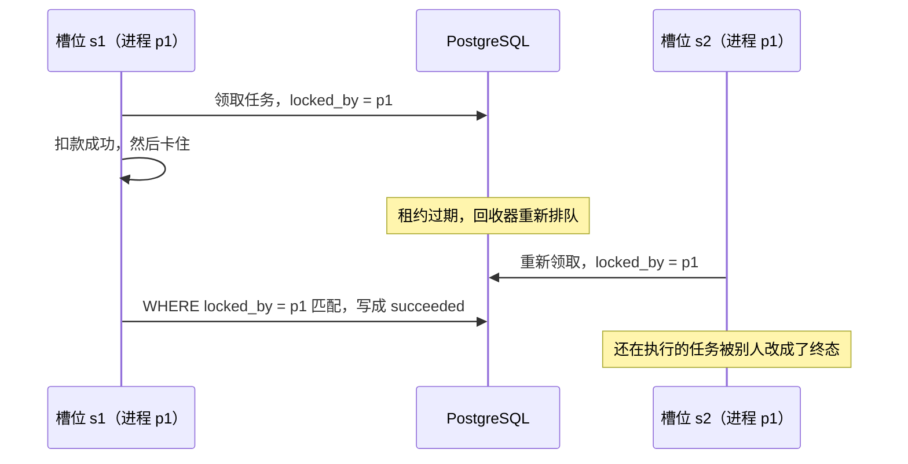

*English version: [Run TLC First, Then Let the AI Write the Code](/posts/tla-plus-for-ai-distributed-code-en/)*

最近在做几个分布式服务。实现的时候发现，AI 写的分布式代码总是漏洞百出。单看每个函数都挺像样：有重试、有超时、有日志，测试也能跑过。问题出在函数和函数之间——落库超时以后写入其实还在路上怎么办，租约过期的那一刻旧 worker 还在写怎么办，滚动发布时新旧两版同时跑怎么办。

我的猜测是，AI 在训练里见过大量“看起来对”的分布式代码，但没怎么练过分布式思维：把每一种交错都过一遍，再问一句“这时候系统还对吗”。它写代码时默认的是单机直觉——一步接着一步，发出去的请求总会有结果，超时了就是失败了。

让 AI 补测试也没用。测试和代码出自同一个思路，盲区一样。补一轮、审一轮、再找到一个反例，修完再审，又是一个。

所以我想要的是一种规范的、强约束的、AI 看得懂并且能一比一照着实现的东西。想来想去，落到了 TLA+ 上。后来在一个 WebSocket 推送服务和一个游戏服务的执行器上都用了这一套。生产代码没法公开，所以我又用同样的方法做了一个开源的小项目，文中所有关于它的结论都可以自己跑出来：

> **示例仓库**：[github.com/tursom/pgqueue-tla](https://github.com/tursom/pgqueue-tla)（文中代码链接都固定在提交 [`bafcc3d`](https://github.com/tursom/pgqueue-tla/tree/bafcc3d)）
>
> ```bash
> make db     # 启动测试用 PostgreSQL
> make tlc    # 20 项模型检查，约 1 分钟，生成 spec/RESULTS.md
> make test   # 在真实 PostgreSQL 上回放 TLC 的反例
> ```
>
> 需要 Go、Java、TLA+ 工具和 Docker。

## 为什么是 TLA+

自然语言写的设计文档不行。“消息落库后返回成功”这句话，没说落库超时怎么算，没说超时之后写入还会不会生效，也没说返回之前进程挂了会怎样。AI 读到这种空白，会用单机直觉补上，补出来的往往就是 bug。

TLA+ 把这些空白都堵死了：

- **状态必须显式列出来。** Redis 里有什么、数据库里有什么、进程内存里有什么、网络上有什么在途请求，都要写成变量。
- **每个动作是原子的。** 前置条件是什么、改了哪些变量、哪些不变，一项都不能省。
- **不确定性是显式的。** 写入可以迟到，进程可以在任意两步之间崩溃或暂停，Redis 可以丢数据或回退。写进规约以后，TLC 会把所有交错穷举一遍，而不是挑几条“正常”路径。
- **它是纯文本。** AI 读得懂也写得出，能放进仓库跟代码一起评审。

TLC 给出的反例是一条具体的执行轨迹，一步一步告诉你系统怎么走进了错误状态。这比任何人或 AI 的“我觉得没问题”都可靠。

## 为什么是现在

TLA+ 已经有二十多年了，Amazon、微软很早就在用它验证核心协议，但它一直没在普通团队里铺开。原因不是价值不够，而是太贵：要学会用状态和动作思考，一份像样的规约要写几周；写完还有配置、哨兵、变异、测试框架、代码对应和验证文档；代码一改，规约还得跟着改。大多数团队就算写了规约，也停在“TLC 通过”这一步。

AI 把这些成本压了下来。起草规约、把 TLC 的反例轨迹翻译成人能读的解释、批量生成变异、写 fuzz 框架、维护代码里的动作注释、整理验证记录，这些体力活现在都可以交给 AI。后面执行器那个项目，三块模型、近三十组配置、七十来个哨兵和变异，从提交记录看是一天之内写完、检查完的。按以前的做法，这是一个人几周的工作量。

需求也在同时变化。AI 让写代码变便宜了，瓶颈从“写出来”转到了“确认它是对的”；AI 在分布式交错上的盲区，又让这种确认变得更紧迫。所以 AI 既是我需要 TLA+ 的原因，也是我用得起 TLA+ 的原因。

但有两样成本没有降。一是判断：故障模型怎么定、性质怎么写、哪些前提可以接受，仍然得人来定。AI 写的规约并不可靠，这套方法能成立，是因为 TLC、哨兵和变异构成了反馈回路，AI 写错了会被机器抓住，而不是因为 AI 写得对。二是算力：状态爆炸还在，一亿个状态照样要跑半小时、占 20GB 左右的磁盘。

还有一个新风险：规约变便宜以后，容易出现“规约表演”——模型很多、结果表很漂亮，却没人真的看懂它在验证什么。门槛降低了，检查模型本身可不可信反而要更严格。后面“踩过的坑”里有一半都是在讲这件事。

## 一个可以自己跑的例子：扣款任务队列

先用示例项目把整套流程完整走一遍，再讲生产项目里的经验。

### 问题

业务方把扣款任务写进 PostgreSQL，多个 worker 进程并发消费，每个任务调用一次外部支付网关。网关支持幂等键：同一个键重复请求不会重复扣款，返回第一次的结果。但请求可能超时——钱可能已经扣了，只是响应丢了。worker 可能崩溃，也可能卡住很久再醒来。要求只有三条：

- 同一个任务不能重复扣款；
- `succeeded` 一定扣过款，`dead` 一定没扣款——业务方会据此通知用户“扣款失败”、释放订单；
- 每个任务最终结束。

完整需求在 [REQUIREMENTS.md](https://github.com/tursom/pgqueue-tla/blob/bafcc3d/REQUIREMENTS.md)，它是两版实现共同的输入。

### AI 直接写出来的版本

[`naive/`](https://github.com/tursom/pgqueue-tla/blob/bafcc3d/naive/naive.go) 是 AI 只看需求、不写规约直接写出来的版本。它看起来相当规矩：`FOR UPDATE SKIP LOCKED` 领取，带租约，有回收器，用任务 ID 作幂等键，写回结果时检查 `locked_by`：

```go
// Finish 根据扣款结果更新任务：成功则完成，失败则重新排队，重试用尽则标记 dead。
func (q *Queue) Finish(ctx context.Context, j *Job, chargeErr error) error {
	if chargeErr == nil {
		_, err := q.DB.Exec(ctx, `
			UPDATE naive_jobs SET state = 'succeeded', locked_by = NULL, locked_until = NULL
			WHERE id = $1 AND locked_by = $2`, j.ID, q.WorkerID)
		return err
	}
	_, err := q.DB.Exec(ctx, `
		UPDATE naive_jobs
		SET state = CASE WHEN attempts >= $3 THEN 'dead' ELSE 'queued' END,
		    locked_by = NULL, locked_until = NULL, last_error = $4
		WHERE id = $1 AND locked_by = $2`, j.ID, q.WorkerID, q.MaxAttempts, chargeErr.Error())
	return err
}
```

`WorkerID` 是 `hostname:pid`，一个进程里的多个并发槽位共用它。这是非常常见的写法，代码评审时大概率也能通过。

### 把它写成规约

[规约](https://github.com/tursom/pgqueue-tla/blob/bafcc3d/spec/JobQueue.tla) 里每个动作对应代码里的一次数据库事务或一次网关调用。用三个开关描述不同的设计：

- `Fenced`：worker 写库时比较 fence（每次领取加一），还是像 naive 一样只比较 `locked_by`；
- `CancelBeforeDead`：后面会讲到；
- `KeyMode`：幂等键按任务生成，还是按每次尝试生成。

naive 版本对应 `Fenced = FALSE`、`CancelBeforeDead = FALSE`、`KeyMode = "job"`。同一份模型因此既能描述 naive 版本，也能描述修正后的设计，还能做变异。

worker 写库时的 WHERE 条件被写成一个单独的定义，直接对应两版代码里的 SQL：

```tla
\* 实现里 worker 写任务行时的 WHERE 条件
Guard(s) ==
    LET j == slot[s].job
    IN IF Fenced THEN job[j].seq = slot[s].seq /\ job[j].state = "running"
                 ELSE job[j].owner = Proc[s]
```

网关的行为按需求如实写出来，包括“响应丢失”：

```tla
\* 调用网关扣款。网关按幂等键去重：
\*   键已关闭     -> 只能 rejected，不扣款
\*   键已扣过款   -> 返回第一次的结果（ok，或响应丢失 lost），不再扣款
\*   新键         -> ok / lost（扣款）或 rejected（明确拒绝，不扣款）
Send(s, out) ==
    /\ slot[s].pc = "claimed"
    /\ LET j == slot[s].job
           k == KeyOf(s)
       IN /\ CASE k \in closed -> out = "rejected"
                [] k \in keys   -> out \in {"ok", "lost"}
                [] OTHER        -> TRUE
          /\ IF out # "rejected" /\ k \notin keys
               THEN /\ keys' = keys \cup {k}
                    /\ charged' = [charged EXCEPT ![j] = @ + 1]
               ELSE UNCHANGED <<keys, charged>>
          /\ slot' = [slot EXCEPT ![s].pc = "sent", ![s].outcome = out]
    /\ UNCHANGED <<job, cancelRes, closed, badWrite, expires, crashes>>
```

时间被抽象成“租约在任意时刻都可能过期”：worker 卡多久、网络多慢，都被一个 `Expire` 动作覆盖，所以检查出来的安全性不依赖任何时间假设。

要检查的性质就是需求里那几句话，外加一条“没有失去领取的 worker 改写任务行”。最后这条用幽灵变量 `badWrite` 在每次写入的时刻独立判断，不复用 `Guard`：

```tla
NoDoubleCharge == \A j \in Jobs : charged[j] <= 1
SucceededMeansCharged == \A j \in Jobs : job[j].state = "succeeded" => charged[j] >= 1
DeadMeansNotCharged == \A j \in Jobs : job[j].state = "dead" => charged[j] = 0
WritesAuthorized == ~badWrite
```

### TLC 的两条反例

naive 版本做到了不重复扣款，这一点 TLC 检查通过。另外两条性质各用 7 步就找到了反例。

**dead 的任务其实扣过款**（`naive-dead`）：

1. 领取任务，第一次扣款成功，但响应丢了；
2. worker 当作失败，任务重新排队；
3. 再次领取，第二次请求因为幂等键命中不会重复扣款，但响应又丢了；
4. 重试用尽，任务被标成 `dead`。用户收到“扣款失败”的通知，钱却已经扣了。

**过时的 worker 改写了别人正在执行的任务**（`naive-writes`）：



两条反例都很短，但都要求“响应丢失、租约过期、回收、重新领取”这些事件按特定顺序发生。正常路径的测试不会撞到它们。

### 写规约时发现：这条需求在原接口下做不到

修正设计时，我一开始的思路是“扣款前先在库里记下可能已扣款，重试用尽时据此区分”。写规约的过程中发现这条路走不通：任务被判定放弃之后，一个早已失去租约的 worker 仍然可能醒来，把扣款请求发出去。数据库里的 fence 拦得住过时的写库，拦不住过时的网关调用。

也就是说，只靠 `Charge` 这一个接口，“`dead` 一定没扣款”在 worker 可能任意卡住的前提下根本做不到。这不是实现问题，是需求和外部接口之间的矛盾。

所以需求做了一次变更：网关要提供 `Cancel(key)`，原子地关闭一个还没扣款的幂等键，并返回这个键是否已经扣过款。真实的支付网关一般都有对应的能力，比如取消一个支付意图之后，它就不能再被确认。变更过程记在需求文档末尾。

这个问题不是 TLC 报出来的，而是把动作和状态逐个写清楚时自己暴露出来的。这也是写规约的价值之一：它逼你回答那些设计文档里可以含糊过去的问题。

### 修正后的设计和检查结果

修正设计有三个机制：

| 机制 | 解决什么 |
| --- | --- |
| **fence**：每次领取加一，worker 的所有写入都带 `WHERE fence = $n AND state = 'running'` | 过时的 worker 改不了任务行 |
| **幂等键按任务生成**：同一个任务的所有尝试共用 `job-<id>` | 重试、过时的 worker 都不会重复扣款 |
| **放弃前先 Cancel**：重试用尽进入 `canceling`，由回收器调用网关 `Cancel`，已扣款则 `succeeded`，否则 `dead` | `dead` 一定没扣款；过时的 worker 之后再扣款会被网关拒绝 |

[`spec/check.sh`](https://github.com/tursom/pgqueue-tla/blob/bafcc3d/spec/check.sh) 一次跑完 20 项检查。每项都写明预期，结果与预期完全一致才算成立，汇总写入 [spec/RESULTS.md](https://github.com/tursom/pgqueue-tla/blob/bafcc3d/spec/RESULTS.md)：

| 分组 | 内容 | 结果 |
| --- | --- | --- |
| naive | 写入授权、dead 一定没扣款 | 各 7 步反例 |
| naive | 不重复扣款、成功一定扣过款、终态不变 | 通过 |
| 修正设计 | 全部安全性。最大配置：3 个槽位、2 个任务、重试 3 次、租约过期 2 次、崩溃 2 次 | 通过，136.6 万个状态，深度 28 |
| 修正设计 | 活性：每个任务最终结束 | 通过 |
| 可达性哨兵 | 6 个预期被违反的场景 | 全部可达，反例 5～9 步 |
| 模型变异 | 去掉 fence / 去掉 Cancel / 幂等键按尝试生成 | 分别违反写入授权 / dead 一定没扣款 / 不重复扣款 |
| 前提 | 网关会遗忘已扣款的幂等键 | 违反不重复扣款，7 步 |

后三组回答的是同一个问题：**检查通过，会不会只是因为模型写错了？**

- 哨兵是一些“预期被违反”的性质，比如“过时的 worker 发出了扣款”“过时的扣款被已关闭的键拒绝”“Cancel 发现其实已经扣过款”。TLC 报违反，说明这些场景在模型里确实走得到。
- 变异是逐个去掉修正设计的机制，确认每一个都不可缺，而且性质写得足够强，能把问题抓出来。
- 前提检查演示的是：模型依赖“网关永久保留幂等键”。真实网关如果有保留期限（有的网关只保留 24 小时），而任务的重试窗口比它长，就会重复扣款。这条前提接入真实网关时必须核对。

### 按规约实现，再用 fuzz 对上

[`queue/`](https://github.com/tursom/pgqueue-tla/blob/bafcc3d/queue/queue.go) 是按规约实现的版本。每个方法只做一次数据库事务或一次网关调用，和模型的原子粒度一致，注释里标出动作名。比如 `Finish` 的 WHERE 条件就是模型里 `Fenced = TRUE` 时的 `Guard`：

```go
// Finish 按扣款结果收尾：成功则完成；否则重新排队，重试用尽则进入 canceling 等待 Cancel。
// 返回 false 表示这次领取已经失效（被回收或被别人接管），什么都没改。
//
// 模型动作：Finish
func (q *Queue) Finish(ctx context.Context, t *Task, out Outcome) (bool, error) {
	var sql string
	args := []any{t.ID, t.Fence}
	if out == OK {
		sql = `
			UPDATE jobs SET state = 'succeeded', locked_by = NULL, lease_until = NULL
			WHERE id = $1 AND fence = $2 AND state = 'running'`
	} else {
		sql = `
			UPDATE jobs
			SET state = CASE WHEN attempts >= $3 THEN 'canceling' ELSE 'queued' END,
			    locked_by = NULL, lease_until = NULL, last_error = $4
			WHERE id = $1 AND fence = $2 AND state = 'running'`
		args = append(args, q.MaxAttempts, outcomeName(out))
	}
	// ...
}
```

[`sim/`](https://github.com/tursom/pgqueue-tla/blob/bafcc3d/sim/sim.go) 按模型的动作在真实 PostgreSQL 上逐步驱动两版实现，每一步检查同样的不变式。判定逻辑不调用被测代码：领取序号由测试框架自己记录，写入是否发生看整行 JSON 的前后快照，扣款次数看假网关的统计。这样被测代码里的判断错了，检查不会跟着错。

TLC 的反例可以原样翻译成测试。下面是 `naive-writes` 那条，同一串动作在 naive 上违反，在 queue 上不违反：

```go
func TestReplayStaleFinish(t *testing.T) {
	// s1 扣款成功后卡住；租约过期被回收；同进程的 s2 重新领取；s1 醒来照样写成 succeeded。
	steps := []Step{claim(0), send(0, gateway.OK), tick, reap, claim(1), finish(0)}

	v, _ := replay(t, newEnv(t, naiveSame), 1, steps)
	if v == nil || v.Property != "WritesAuthorized" {
		t.Fatalf("naive 应违反 WritesAuthorized，得到 %v", v)
	}

	v, states := replay(t, newEnv(t, fixed), 1, steps)
	if v != nil {
		t.Fatalf("queue 不应违反：%v", v)
	}
	if states[0] != "running" {
		t.Fatalf("queue 中过时的 Finish 应被 fence 挡住，任务仍由 s2 执行，得到 %s", states[0])
	}
}
```

`make test` 的输出里能看到 naive 版本在真实数据库上的违反：

```text
naive: 第 6 步违反 WritesAuthorized：s1 已失去领取，仍把任务 1 从 running 改成了 succeeded
naive: 第 6 步违反 DeadMeansNotCharged：任务 1 是 dead，但已扣款 1 次
naive: 第 7 步违反 DeadMeansNotCharged：任务 1 是 dead，但已扣款 1 次
```

第三条是“写规约时发现”的那个场景：任务被放弃之后，过时的 worker 才发出扣款。在 queue 上，这次扣款被已关闭的幂等键拒绝了。

实现侧的全部检查：

| 检查 | 结果 |
| --- | --- |
| 回放 3 条场景（2 条 TLC 反例 + 写规约时发现的 1 条） | naive 上全部复现违反，queue 上全部不违反 |
| 1000 个随机动作程序（固定种子，可复现） | naive 同进程配置撞到 11 次违反，独立进程配置 6 次；queue 全部通过，且最终每个任务都结束 |
| Go 原生 fuzz，60 秒 | 11943 次执行，无违反 |
| 实现变异：用 `go test -overlay` 临时去掉 fence 条件 / 重试用尽直接 dead / 幂等键按尝试生成 | 全部被测试抓到 |

随机测试那一行值得多看一眼。同样的 bug，TLC 直接给出 7 步的最短反例；随机组合在第 52 个程序才第一次撞到 dead 的问题，第 388 个程序才第一次撞到写入授权的问题，命中率大约 1%。而且随机测试用的那组动作——租约过期、响应丢失、回收、崩溃——本身就来自建模。没有模型，连该随机什么都不知道。

### 自己验证

```bash
git clone https://github.com/tursom/pgqueue-tla && cd pgqueue-tla
make db          # 启动测试用 PostgreSQL（127.0.0.1:55432）
make tlc         # 20 项模型检查，全部符合预期时输出“全部符合预期”
make test        # 回放、随机对照、前提演示
make fuzz        # 状态机 fuzz，默认 60 秒
make mutate      # 实现变异，全部被抓到时输出“全部实现变异都被测试抓到”
```

TLC 的完整反例轨迹在 `.tlc/<检查名>/tlc.log`。想看某个机制的作用，可以改 `spec/check.sh` 里的开关重跑，或者改 `queue/queue.go` 再跑 `make test`。

## 在生产项目里

示例项目是为了能公开验证才做的。真正让我下定决心用这套方法的，是下面两个生产项目。

### 推送服务：可靠推送的续传

这是一个 WebSocket 推送服务。每个 topic 的消息有一个递增的 seq，先在 Redis 分配，再写进 Mongo。客户端记住每个 topic 收到的位置，断线重连时带上位置，服务端补发之后的消息。要保证的事情只有一句话：**发布方收到成功的消息，客户端一定能收到。**

难点在缺号。seq 分配了但落库失败、发布方放弃、服务宕机，都会留下缺号；落库还可能超时之后才真正写进去。续传遇到缺号，不越过客户端就卡住，越过了又可能有一条迟到的消息正好落在这个号上，客户端保存位置以后就永远补不回来了。

#### 测试审计修不完

最初的设计用 epoch、30 秒时间窗和恢复时跳号来处理这些情况。实现、测试、审计做了五轮，**每一轮都在“续传位置 + 故障恢复”的组合上找到了漏消息的反例**。修一个，下一轮又冒出一个。到这里我意识到，问题不在某一行代码，而是没人能确认这个算法本身是不是对的。

于是把旧设计写成 TLA+ 模型。结果很说明问题：

- 时间假设都成立时，TLC 检查通过。
- 允许 Mongo 在超时之后才真正写入，**13 步就出现反例**。“不漏消息”实际依赖好几个假设同时成立：落库有时限、时间窗大于落库时限加时钟偏差、恢复跳过的号多于实际烧掉的号。
- 把前四轮审计修过的 bug 放回模型，TLC 都能找到反例，长度 9 到 23 步。第五轮审计发现的并发恢复问题，在把恢复流程拆细以后，由随机模拟复现出来，35 步。

也就是说，前面五轮审计一个个撞出来的问题，模型都能自己翻出来。

更关键的是下一步。把发布拆成“发出写请求 / 落库 / 收到回包”三个独立步骤，再加上“Redis 可以回退到之前的状态”（异步复制的从节点被提升），旧设计和一个中间方案都出现了同一个新反例：恢复流程很早就读到“消息表为空”，然后卡住；期间 Redis 又丢了一次；它按那份过时的读取结果创建了新 epoch，已经确认的消息被抛下了。“回复前检查一下 epoch”挡不住这种情况。这条路径在之前的审计里从来没有出现过。

#### 换一个结构上不可能出错的设计

反例说明 epoch 本身就是问题来源。新设计去掉了 epoch，seq 永远递增：

- **墓碑**：续传要越过缺号时，先在消息表写一条区间墓碑。墓碑和迟到的真实消息靠 `(topic, seq)` 唯一索引竞争同一个起点。
- **栅栏**：写下墓碑后把 Redis 里的栅栏推进到墓碑终点，等从节点复制确认（`WAIT`），**再重新读一次这一段**，补发读到的消息，然后才越过。
- **发布确认**：消息落库后读栅栏。栅栏之下的，去消息表查一下自己有没有被墓碑盖住，盖住了就按失败处理，让发布方重试。

这样一来，被墓碑覆盖的消息要么在栅栏推进之前落库（重新读取会读到并补发），要么在之后落库（确认时一定会看到栅栏、查到墓碑而失败）。30 秒时间窗还在，但它**只影响活性**——过早写墓碑只会让仍在落库的写入失败重试，不会漏消息。时钟偏差、GC 停顿、Mongo 慢写都不再影响正确性。

模型里的核心性质就一行：

```tla
\* 已回复成功的消息不丢：seq 不超过客户端保存的位置时必须已经送达
NoLossAcked ==
    \A m \in Msgs : (proc[m].acked /\ proc[m].seq <= client.pos) => proc[m].seq \in delivered
```

发布确认被拆成两个原子步骤，和实现里的两次存储访问一一对应：

```tla
\* 落库成功后读 Redis：代号未变、栅栏已知且小于自己的 seq 时直接回复成功；否则进入消息表检查
AckRead(m) ==
    /\ proc[m].pc = "waiting"
    /\ \E r \in repo : r.kind = "msg" /\ r.seq = proc[m].seq /\ r.id = m
    /\ IF redis.present /\ redis.known /\ redis.inc = proc[m].inc /\ redis.fence < proc[m].seq
         THEN proc' = [proc EXCEPT ![m].pc = "committed", ![m].acked = TRUE, ![m].skipped = TRUE]
         ELSE proc' = [proc EXCEPT ![m].pc = "checking"]
    /\ UNCHANGED <<redis, repo, writes, rest, client, delivered, losses, nextInc, resumes, tombs>>

\* 消息表检查：被墓碑覆盖则按失败处理，否则回复成功
AckCheck(m) ==
    /\ proc[m].pc = "checking"
    /\ IF Covered(proc[m].seq)
         THEN proc' = [proc EXCEPT ![m].pc = "done"]
         ELSE proc' = [proc EXCEPT ![m].pc = "committed", ![m].acked = TRUE]
    /\ UNCHANGED <<redis, repo, writes, rest, client, delivered, losses, nextInc, resumes, tombs>>
```

TLC 在 2 个发布请求、Redis 丢失或回退 2 次、续传 3 次的规模下检查了 4324 万个状态，通过。因为 TLC 只能覆盖有界规模，又用 Apalache 做了归纳证明：把 `Next` 按 24 个动作拆开，乘以 5 组不变式，一共 120 个检查任务，全部成立。这样“不漏消息”就不再受消息数、续传次数、Redis 丢失次数的限制。

#### 每个机制都要证明自己不可缺

检查通过还不够，还要确认每个步骤都是必要的。做法是逐个去掉关键机制，看 TLC 能不能抓到：

| 去掉的机制 | 结果 |
| --- | --- |
| 写墓碑后不重新读取 | 反例 |
| 发布落库后不读栅栏，直接确认 | 反例 |
| 推进栅栏后不 `WAIT` | 反例 |
| 越过已有墓碑时不推进栅栏 | 反例 |
| 发布确认时不比较代号 | **通过** |

最后一行很有意思：去掉代号比较以后，TLC 检查了 4413 万个状态仍然通过。原因是代号变化时栅栏一定先变成“未知”，这项比较其实是多余的。实现里保留了它作为额外防护，但我们第一次清楚地知道它不承担正确性。

模型还逼出了一个配置问题。模型把 Mongo 当作线性一致的存储，这是一条写在纸面上的前提。回头核对实现时发现，读关注用的是默认的 `local`：在副本集上可能读到别的节点刚写下、还没复制到多数节点的墓碑，按它越过缺号后，如果主节点宕机、墓碑被回滚，迟到的消息就会被确认，而客户端已经越过了它。改成 majority 读以后才和模型的前提对上。这个问题不是 TLC 找到的，而是“把前提写清楚”这件事本身找到的——和示例项目里网关幂等键保留期限的那条前提是一回事。

### 执行器：替用户执行第三方平台命令

第二个项目是一个执行器：替用户登录第三方平台账号，再在这个账号上执行命令，比如兑换激活码、创建好友链接。多实例部署，任务存在 PostgreSQL 里，靠租约和 fence 决定谁在执行。这次一开始就先写模型，分成三块：认证任务的分发、认证的生命周期、命令执行层。

命令层的模型在 2 个实例、2 到 3 条命令的规模下，每组配置检查几百万到几千万个状态，找出了几个设计层面的问题。

**滚动发布时的单向互斥。** 当时代码里还保留着一个“登录关闭”模式，走旧的领取路径，只看旧的 lane，不看认证操作。新路径会等旧命令，旧路径却不等新的，互斥是单向的。TLC 给出的反例：认证还在进行，旧路径的命令照样执行（5 步）；账号已经解绑并由另一个用户授权，旧命令仍然用原用户的身份发出了请求（9 步）。这个服务是全新上线的，最后直接删掉了这个模式。但这件事给了一个长期教训：**滚动发布期间第 N 版和第 N-1 版是同时运行的**。以后改领取、lane、许可这类协调协议，必须能和上一版共存，做不到就用库内开关切换，或者那次发布整体重建。在模型里同时放进两版的动作，就能检查这一点。

**进程暂停越过租约。** worker 拿到许可后卡住，租约过期，恢复流程释放了 lane，别的任务随即领取。worker 醒来后仍然会发出请求。这是租约设计、且对方平台没有 fencing 时固有的窗口，没法彻底消除，只能靠给执行期限留出预留时间把窗口压到很小。但模型同时说明，激活码这一侧不受影响：结果不明的请求一律不重放，激活码的占用一直保留，相关性质在暂停配置下全部通过。知道哪些性质会被破坏、哪些不会，比一句“暂停可能有问题”有用得多。示例项目里“过时的 worker 在任务放弃后才扣款”，就是这个问题的简化版；那里网关能关闭幂等键，所以能彻底解决。

**对账的契约。** 激活码兑换结果不明时，需要一个对账循环去核实。这个循环当时还没实现，模型按两种候选契约来写。其中一种是“查到账号里没有这个游戏，就判定兑换失败并释放激活码”，8 步就出现反例：对账很快查到“未拥有”，释放了激活码；暂停的 worker 随后才真正提交，同一个码可能被另一条命令再次提交。结论是“未拥有”不能当作“未兑换”的证据，只能转人工，或者等租约到期再加足够长的宽限期。**这个问题是在对账代码一行都还没写的时候发现的。**

**好友链接可能变成孤儿。** 已创建的链接只存在 worker 内存里，最后一次写结果时才落库。写结果之前租约过期（数据库慢一点就行），结果没写进去，恢复后命令重放，又创建了一整套，前面那条成了孤儿。不需要崩溃，9 步就能走到。好友链接成本很低，多建几条没有实际损失，最后判定可以接受。修复方案在模型里验证过，但没有实现。TLA+ 的价值不只是找 bug，还包括把“这个问题有多严重、修了之后还剩什么窗口”说清楚，再由人决定修不修。

## 规约之后：让 AI 一比一实现，再用 fuzz 对上

模型验证的是算法，不是代码。代码和模型之间靠这几件事衔接，示例项目里每一件都能直接看到：

**函数注释标出对应的模型动作。** 每个关键函数头上写明它实现的是哪个动作。交给 AI 实现时说得很死：一个动作对应一段原子的存储操作，前置条件就是函数开头的检查，模型里 `UNCHANGED` 的东西代码里不准动。AI 不需要理解协议为什么这么设计，只需要翻译。示例项目的 README 里有一张动作和代码的对照表。

**单元测试逐个覆盖动作，TLC 的反例直接变成回放测试。** 推送服务里，迟到写入落在墓碑内、重新读取补发、墓碑起点被占用、`WAIT` 未确认，每个都有对应的测试。示例项目里，TLC 的每条反例都被翻译成了一个回放测试。

**状态机 fuzz 按模型的动作驱动真实实现。** 输入字节选择模型里的动作，调用真实的数据库和缓存，每一步检查和模型相同的不变式。执行器项目照着推送服务的 fuzz 也做了一套，而且真的抓到了一个实现 bug：操作序列 `[Claim, MarkDispatched, Cancel, Claim, TransitionUnknown]` 在第 4 步把取消原因擦掉了。模型里这一步是对的，是代码没有忠实翻译。

**fuzz 的判定逻辑不能复用生产代码。** 检查“写入是否获得授权”时，不能调用生产代码里那个判断归属的函数，否则那个函数错了，检查也跟着错。期望值要从提交前的原始字段和动作参数独立算出来。示例项目的做法是比较整行 JSON 的前后快照，领取序号由测试框架自己记。

**测试本身也要做变异。** 模型变异检查的是性质写得够不够强，实现变异检查的是测试对代码够不够敏感。示例项目用 `go test -overlay` 临时改坏实现、不碰源码，三个变异全部被测试抓到。两类变异要分开记录，不能互相替代。

## 踩过的坑

**检查通过，可能只是模型写错了。** 这是最大的坑。对付它的就是前面反复出现的两类手段：可达性哨兵证明关键场景走得到，变异证明每个机制都不可缺。

执行器的分发模型审了两轮，查出 11 个问题，基本都是这一类。比如“同一时刻最多一个 worker 能写”这条不变式，由数据结构保证恒成立，根本检查不到实际写入者有没有租约。后来加了一个幽灵变量，在每次写入的时刻独立记录写入者是否持有有效租约，再用“发布不检查租约”的变异确认它能抓到问题——示例项目里的 `badWrite` 就是同样的做法。又比如容量上界的检查，配置里的任务数从来没超过名额，永远不会触发，补了一个任务多于名额的配置才真正测到。

**哨兵写得太宽，会掩盖错误语义。** 生命周期模型的旧版本里，“取消后结束”的哨兵允许多种阻断原因，TLC 报了违反，看起来场景可达。仔细看轨迹才发现，取消后的操作走的是普通超时出口，最终状态是错误的“失败、需要重启”，而不是“已取消”。哨兵要精确到最终状态和原因，不能只看“走到了”。

**预期也会写错。** 做示例项目时，我预期 naive 版本会违反“终态不会再变”，TLC 却报告通过。回头看代码才明白：naive 写终态时清空了 `locked_by`，过时 worker 的写入因此改不了终态。检查脚本要求每项都写明预期、结果必须完全一致，这种“我以为”的错误才不会被一张全绿的结果表掩盖过去。

**原子性的粒度决定能找到什么。** 推送服务那个最隐蔽的反例，是把发布从一个动作拆成三个以后才出现的。规约里一个动作是原子的，实现里如果是“发请求、等落库、收回包”几步，中间能插进别的事件，模型里就必须拆开。反过来，示例项目把一条 `UPDATE` 当作一个原子步骤，因为在 PostgreSQL 里它确实是按行加锁、原子执行的。

**把时间抽象成“任意时刻”。** 推送服务的新模型允许墓碑在任意时刻写下，允许落库在任意时刻发生；示例项目允许租约在任意时刻过期。这样检查出来的安全性就不依赖任何时间假设，时间只用来讨论活性。推送服务旧设计的问题，恰恰是安全性偷偷依赖了时间。

**过近似和精确模型配合着用。** 执行器的分发模型有两版调度器：精确版照着代码的游标扫描和分页来写；过近似版允许任意实例在任意时刻领取任意任务。过近似版包含精确版的所有顺序，状态少得多，可以在更大规模上检查不依赖游标的安全性；精确版负责分页、容量和活性。

**写清楚模型没覆盖什么。** 每份模型文档都有一节“局限”：检查的规模、抽象掉的部分、依赖的前提。“模型通过”和“代码被证明正确”是两回事，文档里不能混着写。

**模型一改，旧结果就作废。** 执行器的生命周期模型记录了模型文件的哈希，检查脚本把模型、配置、脚本的快照和每项的退出码都存下来。模型改过以后，同名配置的旧结果不能再拿来当“通过”的证据。示例项目的结果表由脚本生成，不手抄。

**工程上的几个细节：**

- 把多条不变式合成一个 `Safety` 再检查，违反时 TLC 只会报 `Safety`。想知道具体是哪一条，就在配置里逐条列出。
- 嵌套 `EXCEPT` 里的 `@` 指的是正在被替换的那个字段，不是整条记录。示例项目的第一版规约就在这里报了运行时错误。
- 状态目录很大，大约每亿个状态 20GB。用 `-metadir` 放到仓库外面，别放在 tmpfs 上占内存。
- 12 核的机器同时跑的 TLC 进程不超过 6 个；同时启动多个 TLC 时，它们会在 `/tmp` 下同时解压标准模块，偶尔解析失败，错开启动就好。
- 多 worker 时 TLC 不保证反例最短，要看最短反例就用 1 个 worker。
- Apalache 对整个 `Next` 一次检查一组不变式，跑半小时以上都没结束；按动作拆开后，绝大多数任务 10 到 20 秒，最慢的一个 2.3 小时。
- 常量上界（比如重试最多几次）会让系统在用完以后走不动，TLC 报 deadlock。确认是建模产物之后再关掉死锁检查。

## 最后

AI 缺的不是写代码的能力，而是对“所有可能的交错”的想象力。这件事人其实也不擅长，推送服务那五轮审计就是证明。TLA+ 把这份想象力交给机器去穷举，人只需要回答一个问题：什么叫“对”。

几个项目下来，分工变得很清楚：人定义故障模型和性质，TLC 和 Apalache 负责找反例，AI 把验证过的规约一比一翻译成代码，状态机 fuzz 再检查翻译有没有走样。前期多花的时间不少，但换来的是一个能讲清楚“为什么不会出错”的设计，而不是又一轮“这次应该修好了”。

如果你也在用 AI 写分布式代码，可以从示例项目开始：让你的 AI 只看 REQUIREMENTS.md 写一版队列，接到 `sim` 的 `Impl` 接口上，跑一遍回放测试，看看它能不能扛住 TLC 给出的那几条反例。
